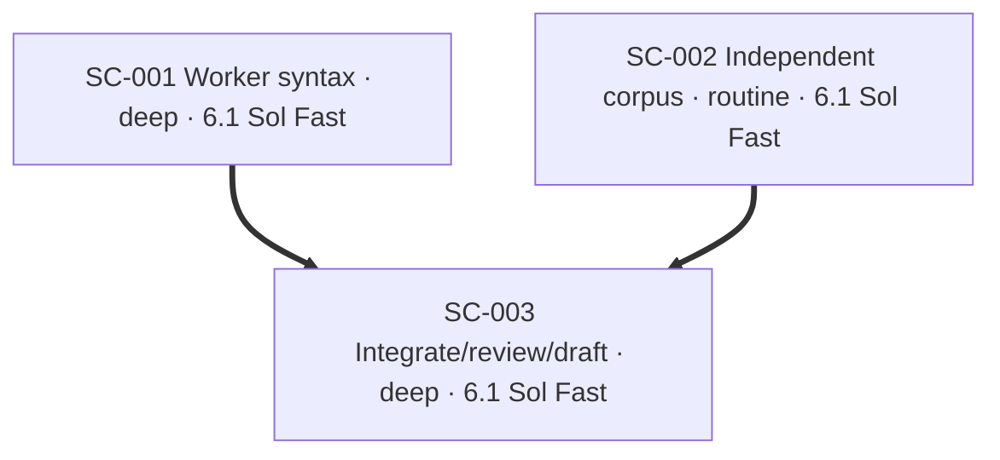

# Plan: sound Worker MCP signature checks

Repository: `vu1n/kypp`. Base: `92dc50c05d0688b6644e89c6b0a6343b29d67713`.
Starting checkout: clean `main`; no staged, unstaged, or untracked task files.
Integration branch: `codex/speccheck-worker-signatures`.
Executor pin: GPT 6.1 Sol Fast (`gpt-6.1-sol`, low reasoning), for delegated work.

PR23 is merged and already guards reference-cache dependencies, baseline authority,
and the POST /sync exception. Continue its deterministic MVP with syntax-tree
enumeration of the Worker's TOOLS input schemas. Unknown array entries or schema
constructs must prevent conformance; a covered verify parameter remains a
counterexample even when another entry is unknown. This is scoped signature
checking, not runtime schema evaluation or a proof of global absence.

The corpus lane independently relabels the exposed PR23 holdout as regressions and
freezes fresh cases before inspecting the implementation. The implementation lane
must not read that lane's files. Evaluate the frozen corpus only after implementation
settles; if results lead to fixes, disclose exposure and move those cases to
regressions. No CI result or reviewer silence implies claim conformance.

Authorization covers branch/push/draft-PR actions and in-scope fixes. No merge,
deployment, decision ratification, billed cloud review, or use of the separate
stateless-agent attachment is authorized here. Ratified docs remain unchanged.

## SC-001 — Worker syntax and evidence

Replace the Worker text scanner with a bounded TypeScript syntax-tree parser.
Use tree-sitter with an optional checker dependency group and lazy loading; absence
of parser dependencies produces an explicit coverage gap. Retain same-file literal
schema support, reject unsupported syntax conservatively, preserve partial known
counterexamples, and invalidate syntax facts produced by the old scanner. Remove
obsolete scanner helpers. Tests must exercise real parser shapes and the evaluator,
with red-first evidence for skipped entries and lost counterexamples. CI must
install the checker extras and run the checker tests and benchmark before emitting
the advisory report. Existing CLI exit/report/no-write contracts remain intact.

```yaml
id: SC-001
task_type: bug_fix
depth: deep
executor: gpt-6.1-sol-low
depends_on: []
footprint:
  modifies:
    - "speccheck/syntax.py::*"
    - "speccheck/evaluate.py::eval_mcp_no_verify"
    - "pyproject.toml::*"
    - ".github/workflows/spec-consistency.yml::*"
  creates:
    - "speccheck/ts_syntax.py"
    - "speccheck/tests/test_ts_syntax.py"
produces:
  - "speccheck/ts_syntax.py::typescript_mcp_tools"
  - "speccheck/syntax.py::cached_ts_mcp"
gate: "Checker tests pass with real tree-sitter dependencies; literal verify findings survive unrelated coverage gaps; unsupported entries never conform; old disk syntax facts are not reused"
```

## SC-002 — Independent evaluation corpus

Reclassify every exposed holdout case from PR23 as regression data. Update CLI,
benchmark, and split tests accordingly. Author and freeze a small independent
Worker-signature holdout before reading SC-001. Record provenance and the exact
freeze commit in a Markdown evaluation document; report false conformance,
abstention, and coverage separately for tuning, regression, holdout, and smoke.
Do not alter the checker to make cases pass. Preserve existing case inputs and
the smoke-only accuracy caveat. The parent will evaluate the frozen cases.

```yaml
id: SC-002
task_type: test
depth: routine
executor: gpt-6.1-sol-low
depends_on: []
footprint:
  modifies:
    - "speccheck/bench_cases.py::*"
    - "speccheck/bench.py::*"
    - "speccheck/cli.py::*"
    - "speccheck/tests/test_bench.py::*"
  creates:
    - "speccheck/holdout_cases.py"
    - "docs/spec-check-evaluation.md"
produces:
  - "speccheck/bench_cases.py::all_cases"
  - "speccheck/holdout_cases.py::holdout_cases"
gate: "All 13 exposed PR23 holdout inputs remain as regressions; fresh cases are committed before implementation inspection; split selection and metric tests pass; no holdout tuning is claimed"
```

## SC-003 — Integrate, test, review, and draft PR

Integrate the disjoint lanes, run required checks, evaluate the frozen corpus, and
record actual results. Run tighten and structural review. Commit and push the
complete diff; verify a clean task scope and identical remote head before a fresh
blank-context correctness reviewer reads immutable base/head commits. Run mutants
in a scratch worktree. Request a separate static security pass after correctness.
Open a draft PR only after correctness clears; monitor exact-head CI and address
in-scope findings. CI's draft mergeability refusal is expected and is reported
separately from check conclusions. Leave the PR draft for the user's merge decision.

```yaml
id: SC-003
task_type: generic
depth: deep
executor: gpt-6.1-sol-low
depends_on: [SC-001, SC-002]
footprint:
  modifies:
    - "PLAN.md::*"
    - ".brief/docs/features.md::*"
  creates:
    - "docs/spec-check-continuation.md"
gate: "Required tests/governance pass; frozen evaluation results and mutant results are durable; pushed exact head receives independent correctness and separate security review; draft PR has exact-head CI evidence and remaining limits"
```

## Status

- Initial checker baseline: 19 tests passed.
- kypp MCP tools absent after tool discovery; briefing/recall/claim skipped per AGENTS.md.
- Cloud skill: `/workspace/dev/codex-skills/ship-it/SKILL.md`; repo `.agents/` absent.
- CLI Brief uses the workflow-pinned v0.4.2 with cache under `/workspace`.
- No implementation or evaluation results yet.

## Graph


