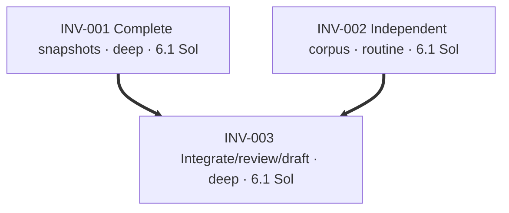

# Plan: complete source inventories for advisory checks

Repository: `vu1n/kypp`. Base: `0e80abc1bcafa1aed1ff312bc2827126a9290011`.
Starting branch: clean `codex/speccheck-sql-migrations` at `945e7235e760370342a59e227fbac3b0c8ff5485`.
New independent branch: `codex/speccheck-source-inventory`, directly from main.
PR25 (`c10f3c7`) and PR26 (`945e723`) are open and untouched. Their changed
symbols do not overlap this source-loading increment; no stack dependency.

An unreadable selected file is currently listed but omitted from `load_files`.
The reference rule can then say `conforms` over an incomplete inventory. A real
temporary Git repository reproduced this with a broken reference followed by
non-UTF-8 bytes: the file was listed, not loaded, and doc-refs conformed.
The outcome is a complete selected-text snapshot or an explicit `GitError`, not
a report claiming coverage of files silently discarded. Git filenames must be
enumerated without line/quote ambiguity. Worktree deletions remain valid changes;
non-regular selected entries must not be followed or treated as source text.

Use the current cloud ship-it skill at `/workspace/dev/codex-skills/ship-it/SKILL.md`.
Executors stay pinned to `gpt-6.1-sol`, low reasoning, on this existing task.
Fast service-tier readback is unavailable. No merge, deployment, paid experiment,
runtime Kypp change, active-decision edit or ratification is authorized.
The separate substrate task owns `.brief/amendments/scope-keys-decay.md`,
`.brief/amendments/compose-surface.md` and its SIGNOFF entries; do not touch them.
This increment is not Pillbox work or a redesign of reference indexing.

## INV-001 — Complete selected-text snapshots

Fix Git/worktree enumeration and loading. Preserve literal paths containing spaces,
tabs, newlines and non-ASCII characters, in committed and worktree modes. Reject
unreadable/non-UTF-8 selected files and selected non-regular entries explicitly
instead of omitting them. An intentionally absent worktree file is a deletion,
not a read failure; its content and path must be absent from the returned snapshot.
Retain existing tuple interfaces and the CLI contract: exit zero after a report,
including findings, but failure to read the source tree is a nonzero broken check.
No successful report or cache write should follow a source read failure.

```yaml
id: INV-001
task_type: bug_fix
depth: deep
executor: gpt-6.1-sol-low
depends_on: []
footprint:
  modifies:
    - "speccheck/gitio.py::*"
  creates:
    - "speccheck/tests/test_gitio.py"
produces:
  - "speccheck/gitio.py::load_files"
gate: "Real Git/worktree tests prove unusual-path round trips, explicit decoding/read/type failures, deletion handling, and no external symlink content reads; red-first examples go green without CLI/evaluator changes"
```

## INV-002 — Independent input corpus

Author small end-to-end cases from the contract using real temporary Git repos.
Read CLI and fixture interfaces, but do not inspect INV-001 or its worktree.
Freeze inputs and expected outcomes in a commit before scoring. Include clean
controls, adverse file contents, unusual filenames, committed/worktree paths,
intentional deletions and ignored/out-of-scope controls. A produced report must
retain a visible broken-reference or verify-argument counterexample when present;
an unreadable selected snapshot must fail without producing report artifacts.
First scoring happens after implementation settles, with honest exposure notes.

```yaml
id: INV-002
task_type: test
depth: routine
executor: gpt-6.1-sol-low
depends_on: []
footprint:
  creates:
    - "speccheck/tests/test_source_inventory_corpus.py"
    - "docs/spec-check-source-evaluation.md"
produces:
  - "speccheck/tests/test_source_inventory_corpus.py::CASES"
gate: "Case inputs/labels frozen before scoring or implementation inspection; runnable end-to-end CLI corpus asserts truthful report coverage or explicit loading failure, with durable provenance"
```

## INV-003 — Integration, review and draft PR

Integrate the disjoint lanes, then score the frozen corpus. Run appropriate checker
tests, existing benchmark and required Brief checks. Tighten the owned diff and
perform independent structural review. Test meaningful mutants in an isolated
scratch lane. Commit, push and pin the immutable head before blank-context
correctness review; request the separate static security pass after correctness.
Create a draft PR with actual review and CI evidence; preserve draft status.

```yaml
id: INV-003
task_type: generic
depth: deep
executor: gpt-6.1-sol-low
depends_on: [INV-001, INV-002]
footprint:
  modifies:
    - "PLAN.md::*"
    - ".brief/docs/features.md::*"
  creates:
    - "docs/spec-check-source-inventory.md"
gate: "Local tests and Brief checks pass; frozen first results are recorded; mutants are killed or addressed; exact pushed head clears correctness and separate security review; draft PR has successful exact-head workflows"
```

## Status

- Current main, PR25 and PR26 verified before choosing scope.
- All selected files on the three inspected branches currently decode; no existing binary-selected blocker.
- Kypp MCP tools absent after discovery; proceed per AGENTS.md.
- No SIGNOFF edit expected for this checker-only change; any required addition must preserve others' lines.

## Graph


