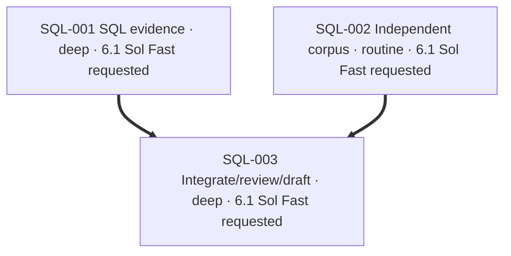

# Plan: SQL migration evidence for the spec checker

Repository: `vu1n/kypp`. Initial base: `92dc50c05d0688b6644e89c6b0a6343b29d67713`.
Current review/PR base: `0e80abc1bcafa1aed1ff312bc2827126a9290011` (published PR24 merge).
Starting checkout: clean PR24 branch at `98db85cf222ebb21379b11362efcd745beeba1d1`.
New independent integration branch: `codex/speccheck-sql-migrations`, from main.
PR24 was initially open and ready for review. Another actor merged it at 02:36:37 UTC
as `0e80abc1bcafa1aed1ff312bc2827126a9290011`; this task did not merge or rewrite it.
Its published changes are integrated before testing the combined checker.

Use `/workspace/dev/codex-skills/ship-it/SKILL.md`; this is the cloud equivalent of
the requested skill. Keep the existing task rather than switching runtimes.
Delegated executors are pinned to `gpt-6.1-sol` with low reasoning; the tool API
does not expose a Fast-tier readback. No verified tier switch is claimed.

The next deterministic MVP increment replaces SQL word searches with bounded
statement evidence. A comment containing DEFAULT cannot satisfy a NOT NULL column;
ADD COLUMN in a string/comment cannot turn DROP into an additive migration;
creating a named version table cannot fall through the additive rule as conforming.
Unknown syntax abstains, while known violations survive unrelated entry gaps.
The retired additive-migrations@0002 bullet remains the existing registry source;
do not pretend it is an active governance constraint, rewrite it, or test against
head proposals. Runtime idempotence remains unresolved.

This work is independent of PR24: no TypeScript parser, Worker behavior, benchmark
split/CLI changes, optional dependency changes, or competing CI test-step additions.
No Kypp/Huddles substrate design or Pillbox worker-usage changes. No merge/deploy.

## SQL-001 — SQL statement analysis and evaluator

Implement a stdlib-only, bounded SQLite-shaped lexical/structural analyzer without
executing supplied SQL. Distinguish comments, strings, quoted identifiers, clause
positions and statement boundaries. Conservatively support the ordinary literal
ADD COLUMN declarations in this repo; valid unsupported/ambiguous syntax stays
unresolved. This is syntax/policy checking, not proof of engine acceptance, default
semantics, existing-row compatibility or runtime idempotence. Preserve scalar
classify_migration compatibility where practical and expose reasons to the evaluator.
Only actual version-table creation supports the version-table counterexample.
Known non-additive operations and NOT NULL without a real DEFAULT must violate;
literal contents or unrelated identifiers cannot supply SQL clauses.

```yaml
id: SQL-001
task_type: bug_fix
depth: deep
executor: gpt-6.1-sol-low
depends_on: []
footprint:
  modifies:
    - "speccheck/syntax.py::*"
    - "speccheck/evaluate.py::eval_schema_columns"
    - "speccheck/evaluate.py::eval_schema_idempotence"
    - "speccheck/evaluate.py::SCHEMA_SCOPE"
  creates:
    - "speccheck/sqlsyntax.py"
    - "speccheck/tests/test_sqlsyntax.py"
produces:
  - "speccheck/sqlsyntax.py::analyze_migration"
  - "speccheck/syntax.py::classify_migration"
gate: "Real parser/evaluator tests pass; comment/string decoys cannot conform; unsupported syntax abstains; known counterexamples survive entry gaps; real version-table creation violates both relevant registry checks"
```

## SQL-002 — Independent schema corpus

Author and commit a small fresh corpus from the pinned bullet and SQLite grammar
before reading SQL-001. Read fixture/model/engine interfaces only; do not inspect
new implementation or its workspace. Freeze expected labels before evaluating.
Keep the corpus as runnable unit tests so PR24's future discovery step can pick it
up without duplicate CI work. The parent will evaluate it after implementation
settles and record false conformance, abstention and coverage using existing metric
definitions. Do not tune expectations from results. Exposed cases become regression
confirmation after first evaluation; document the freeze identity and limits.

```yaml
id: SQL-002
task_type: test
depth: routine
executor: gpt-6.1-sol-low
depends_on: []
footprint:
  creates:
    - "speccheck/tests/test_schema_corpus.py"
    - "docs/spec-check-schema-evaluation.md"
produces:
  - "speccheck/tests/test_schema_corpus.py::CASES"
gate: "Corpus expectations committed before implementation inspection or scoring; literal clean controls and adverse/unknown cases are independently labeled; freeze hash/provenance are durable"
```

## SQL-003 — Integration, review, exact-head CI and draft PR

Integrate the disjoint lanes, run the full checker tests and benchmark, and evaluate
the frozen corpus. Tighten, structural review, mutant checks in scratch, and fresh
blank-context correctness review of a clean pushed immutable head precede the PR.
Request separate static security finder/refuter after correctness. Publish a draft
PR against main with no PR24 dependency. Exact-head CI must pass; the already-published PR24 workflow discovers the new unit
tests and runs the benchmark, so no duplicate test step is added here.
The draft merge-gate refusal is expected and distinct from check conclusions.

```yaml
id: SQL-003
task_type: generic
depth: deep
executor: gpt-6.1-sol-low
depends_on: [SQL-001, SQL-002]
footprint:
  modifies:
    - "PLAN.md::*"
    - ".brief/docs/features.md::*"
  creates:
    - "docs/spec-check-sql-migrations.md"
gate: "Required local tests/governance and frozen evaluation pass; exact pushed head clears independent correctness and separate security review; draft PR has actual exact-head CI evidence and no PR24 dependency"
```

## Status

- Main baseline checker suite: 19 tests passed.
- kypp MCP tools absent after discovery; skip memory calls per AGENTS.md.
- Cloud ship-it available; repository `.agents/` directory absent.
- Brief v0.4.2 uses writable cache/tool dirs under `/workspace/.cache`.
- No active decision edits, runtime changes, merge or deployment are authorized.

## Integration deviation

- PR24 merged externally while lanes ran. Integrated current main after both
  independent lanes landed; retained its TypeScript analyzer and SQL changes together.
- Resolved the syntactic conflict by removing both obsolete scanner helpers and
  obsolete SQL regexes. PLAN now describes this increment; PR24's plan remains in
  Git history and its evidence documents remain in the combined tree.
- SQL implementation commit: `a92939f`; corpus freeze: `22f68268b268d3d52133ed88c98bb9a1f44831c1`.
- First evaluation at `6716f88` found zero false conformance, 27.3% column
  abstention and 72.7% coverage, with one missed DROP INDEX counterexample.
  Added its structural shape without changing labels; all cases are now exposed.
- Added meaningful migration-cache and budget checks. A red-first boundary test
  found that a final statement without a semicolon escaped the 128-statement
  limit; it now abstains. No SQL is executed by these checks.
- Initial pushed-head review cleared `8bf7738` with risk low. Mutation testing
  killed 11 changes and exposed a missing token-budget assertion; its regression
  was added before a new immutable final-head review.

## Graph


