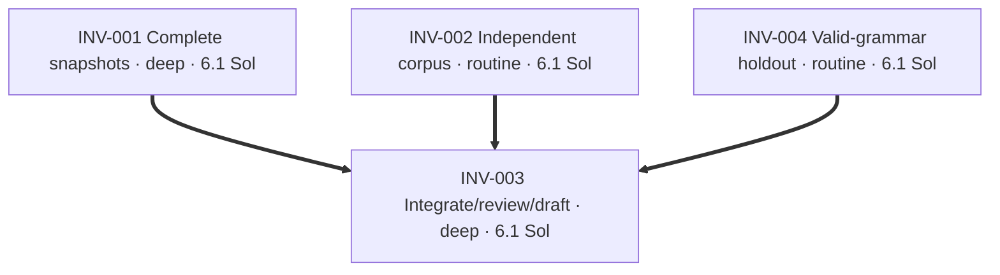
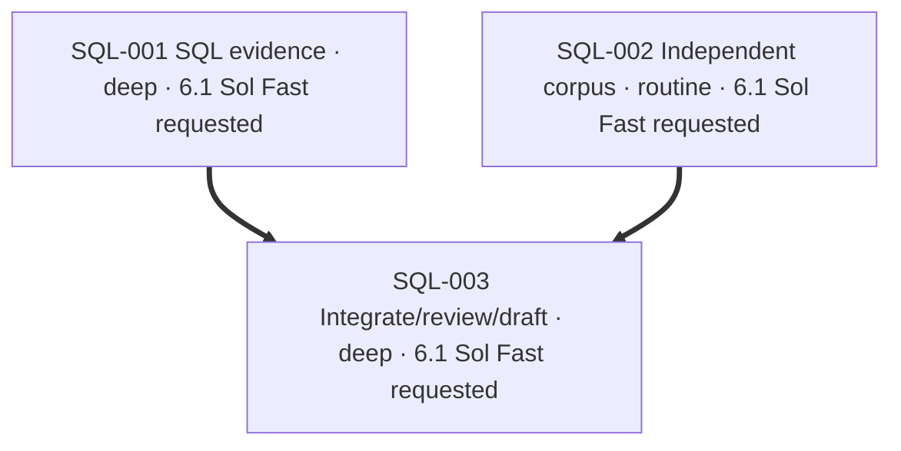

# Plan: complete source inventories for advisory checks

Repository: `vu1n/kypp`. Base: `0e80abc1bcafa1aed1ff312bc2827126a9290011`.
Starting branch: clean `codex/speccheck-sql-migrations` at `945e7235e760370342a59e227fbac3b0c8ff5485`.
New independent branch: `codex/speccheck-source-inventory`, directly from main.
PR25 (`c10f3c7`) and PR26 (`945e723`) are open and untouched. Their changed
symbols do not overlap this source-loading increment; no stack dependency.

An unreadable selected file is currently listed but omitted from `load_files`.
The reference rule can then say `conforms` over an incomplete inventory. A real
temporary Git repository reproduced this with a broken reference followed by
non-UTF-8 bytes: the file was listed, not loaded, and doc-refs conformed.
The outcome is a complete selected-text snapshot or an explicit `GitError`, not
a report claiming coverage of files silently discarded. Git filenames must be
enumerated without line/quote ambiguity. Worktree deletions remain valid changes;
non-regular selected entries must not be followed or treated as source text.

Use the current cloud ship-it skill at `/workspace/dev/codex-skills/ship-it/SKILL.md`.
Executors stay pinned to `gpt-6.1-sol`, low reasoning, on this existing task.
Fast service-tier readback is unavailable. No merge, deployment, paid experiment,
runtime Kypp change, active-decision edit or ratification is authorized.
The separate substrate task owns `.brief/amendments/scope-keys-decay.md`,
`.brief/amendments/compose-surface.md` and its SIGNOFF entries; do not touch them.
This increment is not Pillbox work or a redesign of reference indexing.

## INV-001 — Complete selected-text snapshots

Fix Git/worktree enumeration and loading. Preserve literal paths containing spaces,
tabs, newlines and non-ASCII characters, in committed and worktree modes. Reject
unreadable/non-UTF-8 selected files and selected non-regular entries explicitly
instead of omitting them. An intentionally absent worktree file is a deletion,
not a read failure; its content and path must be absent from the returned snapshot.
Retain existing tuple interfaces and the CLI contract: exit zero after a report,
including findings, but failure to read the source tree is a nonzero broken check.
No successful report or cache write should follow a source read failure.

```yaml
id: INV-001
task_type: bug_fix
depth: deep
executor: gpt-6.1-sol-low
depends_on: []
footprint:
  modifies:
    - "speccheck/gitio.py::*"
  creates:
    - "speccheck/tests/test_gitio.py"
produces:
  - "speccheck/gitio.py::load_files"
gate: "Real Git/worktree tests prove unusual-path round trips, explicit decoding/read/type failures, deletion handling, and no external symlink content reads; red-first examples go green without CLI/evaluator changes"
```

## INV-002 — Independent input corpus

Author small end-to-end cases from the contract using real temporary Git repos.
Read CLI and fixture interfaces, but do not inspect INV-001 or its worktree.
Freeze inputs and expected outcomes in a commit before scoring. Include clean
controls, adverse file contents, unusual filenames, committed/worktree paths,
intentional deletions and ignored/out-of-scope controls. A produced report must
retain a visible broken-reference or verify-argument counterexample when present;
an unreadable selected snapshot must fail without producing report artifacts.
First scoring happens after implementation settles, with honest exposure notes.

```yaml
id: INV-002
task_type: test
depth: routine
executor: gpt-6.1-sol-low
depends_on: []
footprint:
  creates:
    - "speccheck/tests/test_source_inventory_corpus.py"
    - "docs/spec-check-source-evaluation.md"
produces:
  - "speccheck/tests/test_source_inventory_corpus.py::CASES"
gate: "Case inputs/labels frozen before scoring or implementation inspection; runnable end-to-end CLI corpus asserts truthful report coverage or explicit loading failure, with durable provenance"
```

## INV-003 — Integration, review and draft PR

Integrate the disjoint lanes, then score the frozen corpus. Run appropriate checker
tests, existing benchmark and required Brief checks. Tighten the owned diff and
perform independent structural review. Test meaningful mutants in an isolated
scratch lane. Commit, push and pin the immutable head before blank-context
correctness review; request the separate static security pass after correctness.
Create a draft PR with actual review and CI evidence; preserve draft status.

```yaml
id: INV-003
task_type: generic
depth: deep
executor: gpt-6.1-sol-low
depends_on: [INV-001, INV-002, INV-004]
footprint:
  modifies:
    - "PLAN.md::*"
    - ".brief/docs/features.md::*"
  creates:
    - "docs/spec-check-source-inventory.md"
gate: "Local tests and Brief checks pass; frozen first results are recorded; mutants are killed or addressed; exact pushed head clears correctness and separate security review; draft PR has successful exact-head workflows"
```

## INV-004 — Valid-grammar independent holdout

The first frozen corpus contained invalid reference sentinels and a misdirected
read-denial fault. Retain the original freeze and observed results; repair it as
exposed regression evidence. A new blank-context author freezes a small separate
set using the public reference grammar and unittest interfaces, before seeing
the source loader or existing corpus. This new set is first scored after freeze.

```yaml
id: INV-004
task_type: test
depth: routine
executor: gpt-6.1-sol-low
depends_on: []
footprint:
  creates:
    - "speccheck/tests/test_source_inventory_holdout.py"
    - "docs/spec-check-source-holdout.md"
produces:
  - "speccheck/tests/test_source_inventory_holdout.py::CASES"
gate: "Small independent cases use valid public reference grammar; frozen inputs/labels committed before scoring or implementation exposure; first results and limitations recorded without retuning labels"
```

## Status

- Current main, PR25 and PR26 verified before choosing scope.
- All selected files on the three inspected branches currently decode; no existing binary-selected blocker.
- Kypp MCP tools absent after discovery; proceed per AGENTS.md.
- No SIGNOFF edit expected for this checker-only change; any required addition must preserve others' lines.

## Deviations

- Original corpus freeze: `999b6a2b6aa509b4982fa6fb47cf5cc9fcb72b46`.
  First scoring at `bb98fa3` observed 15/26 passes and 11 failures, but the
  eleven reference sentinels had out-of-grammar revisions. The read-denied pass
  was also invalid: its helper raised a type error on a subprocess pipe handle.
  Fourteen valid controls/loading cases passed. This is harness evidence, not
  a false-conformance rate. Repair the harness and disclose input changes;
  use INV-004 for a new independently frozen first observation.
- INV-004 freeze `16f548fa247988821ab80f90f9afff1524615f78` first scored at
  `fc1f877`: eleven valid cases passed; one head-only Brief-note expectation
  exceeded the reference rule's declared scope. Corrected that label against
  the existing contract without widening the checker. The frozen original is
  preserved; corrected twelve-case passing runs are regression confirmation.
- Repaired original 26-case corpus passed. Local suite now has 72 passing methods;
  all fifteen mutants are killed after addressing three missing test boundaries
  and the correctness review's excluded-parent-symlink regression.
- Tighten removed the private pass-through reader and redundant branch. The
  scoped loader/corpus tests were re-run, then the full checker suite passed.
  Independent structural review found no high-confidence blocker. No runtime,
  amendment, active decision or SIGNOFF edit was needed.
- Pushed-head correctness at `d68aaf8` found strict traversal applied to excluded
  linked asset directories. A real red-first Git fixture demonstrated the abort;
  excluded entries now receive existence-only checks without content reads. The
  committed fix is pushed and reviewed again before opening the draft PR.
- Fresh correctness at `2d65576` identified excluded descendants when a directory
  is replaced by a file. A real red-first fixture reproduced ENOTDIR; only excluded
  existence checks now treat that condition as absence. Strict selected-source
  traversal is unchanged. The final commit must receive a new independent review.

## Graph



---

The SQL plan below landed on main in #26 (`b5102f6`). It is kept with the source-inventory plan above. Neither plan changes the other's checker behavior.

# Plan: SQL migration evidence for the spec checker

Repository: `vu1n/kypp`. Initial base: `92dc50c05d0688b6644e89c6b0a6343b29d67713`.
Current review/PR base: `0e80abc1bcafa1aed1ff312bc2827126a9290011` (published PR24 merge).
Starting checkout: clean PR24 branch at `98db85cf222ebb21379b11362efcd745beeba1d1`.
New independent integration branch: `codex/speccheck-sql-migrations`, from main.
PR24 was initially open and ready for review. Another actor merged it at 02:36:37 UTC
as `0e80abc1bcafa1aed1ff312bc2827126a9290011`; this task did not merge or rewrite it.
Its published changes are integrated before testing the combined checker.

Use `/workspace/dev/codex-skills/ship-it/SKILL.md`; this is the cloud equivalent of
the requested skill. Keep the existing task rather than switching runtimes.
Delegated executors are pinned to `gpt-6.1-sol` with low reasoning; the tool API
does not expose a Fast-tier readback. No verified tier switch is claimed.

The next deterministic MVP increment replaces SQL word searches with bounded
statement evidence. A comment containing DEFAULT cannot satisfy a NOT NULL column;
ADD COLUMN in a string/comment cannot turn DROP into an additive migration;
creating a named version table cannot fall through the additive rule as conforming.
Unknown syntax abstains, while known violations survive unrelated entry gaps.
The retired additive-migrations@0002 bullet remains the existing registry source;
do not pretend it is an active governance constraint, rewrite it, or test against
head proposals. Runtime idempotence remains unresolved.

This work is independent of PR24: no TypeScript parser, Worker behavior, benchmark
split/CLI changes, optional dependency changes, or competing CI test-step additions.
No Kypp/Huddles substrate design or Pillbox worker-usage changes. No merge/deploy.

## SQL-001 — SQL statement analysis and evaluator

Implement a stdlib-only, bounded SQLite-shaped lexical/structural analyzer without
executing supplied SQL. Distinguish comments, strings, quoted identifiers, clause
positions and statement boundaries. Conservatively support the ordinary literal
ADD COLUMN declarations in this repo; valid unsupported/ambiguous syntax stays
unresolved. This is syntax/policy checking, not proof of engine acceptance, default
semantics, existing-row compatibility or runtime idempotence. Preserve scalar
classify_migration compatibility where practical and expose reasons to the evaluator.
Only actual version-table creation supports the version-table counterexample.
Known non-additive operations and NOT NULL without a real DEFAULT must violate;
literal contents or unrelated identifiers cannot supply SQL clauses.

```yaml
id: SQL-001
task_type: bug_fix
depth: deep
executor: gpt-6.1-sol-low
depends_on: []
footprint:
  modifies:
    - "speccheck/syntax.py::*"
    - "speccheck/evaluate.py::eval_schema_columns"
    - "speccheck/evaluate.py::eval_schema_idempotence"
    - "speccheck/evaluate.py::SCHEMA_SCOPE"
  creates:
    - "speccheck/sqlsyntax.py"
    - "speccheck/tests/test_sqlsyntax.py"
produces:
  - "speccheck/sqlsyntax.py::analyze_migration"
  - "speccheck/syntax.py::classify_migration"
gate: "Real parser/evaluator tests pass; comment/string decoys cannot conform; unsupported syntax abstains; known counterexamples survive entry gaps; real version-table creation violates both relevant registry checks"
```

## SQL-002 — Independent schema corpus

Author and commit a small fresh corpus from the pinned bullet and SQLite grammar
before reading SQL-001. Read fixture/model/engine interfaces only; do not inspect
new implementation or its workspace. Freeze expected labels before evaluating.
Keep the corpus as runnable unit tests so PR24's future discovery step can pick it
up without duplicate CI work. The parent will evaluate it after implementation
settles and record false conformance, abstention and coverage using existing metric
definitions. Do not tune expectations from results. Exposed cases become regression
confirmation after first evaluation; document the freeze identity and limits.

```yaml
id: SQL-002
task_type: test
depth: routine
executor: gpt-6.1-sol-low
depends_on: []
footprint:
  creates:
    - "speccheck/tests/test_schema_corpus.py"
    - "docs/spec-check-schema-evaluation.md"
produces:
  - "speccheck/tests/test_schema_corpus.py::CASES"
gate: "Corpus expectations committed before implementation inspection or scoring; literal clean controls and adverse/unknown cases are independently labeled; freeze hash/provenance are durable"
```

## SQL-003 — Integration, review, exact-head CI and draft PR

Integrate the disjoint lanes, run the full checker tests and benchmark, and evaluate
the frozen corpus. Tighten, structural review, mutant checks in scratch, and fresh
blank-context correctness review of a clean pushed immutable head precede the PR.
Request separate static security finder/refuter after correctness. Publish a draft
PR against main with no PR24 dependency. Exact-head CI must pass; the already-published PR24 workflow discovers the new unit
tests and runs the benchmark, so no duplicate test step is added here.
The draft merge-gate refusal is expected and distinct from check conclusions.

```yaml
id: SQL-003
task_type: generic
depth: deep
executor: gpt-6.1-sol-low
depends_on: [SQL-001, SQL-002]
footprint:
  modifies:
    - "PLAN.md::*"
    - ".brief/docs/features.md::*"
  creates:
    - "docs/spec-check-sql-migrations.md"
gate: "Required local tests/governance and frozen evaluation pass; exact pushed head clears independent correctness and separate security review; draft PR has actual exact-head CI evidence and no PR24 dependency"
```

## Status

- Main baseline checker suite: 19 tests passed.
- kypp MCP tools absent after discovery; skip memory calls per AGENTS.md.
- Cloud ship-it available; repository `.agents/` directory absent.
- Brief v0.4.2 uses writable cache/tool dirs under `/workspace/.cache`.
- No active decision edits, runtime changes, merge or deployment are authorized.

## Integration deviation

- PR24 merged externally while lanes ran. Integrated current main after both
  independent lanes landed; retained its TypeScript analyzer and SQL changes together.
- Resolved the syntactic conflict by removing both obsolete scanner helpers and
  obsolete SQL regexes. PLAN now describes this increment; PR24's plan remains in
  Git history and its evidence documents remain in the combined tree.
- SQL implementation commit: `a92939f`; corpus freeze: `22f68268b268d3d52133ed88c98bb9a1f44831c1`.
- First evaluation at `6716f88` found zero false conformance, 27.3% column
  abstention and 72.7% coverage, with one missed DROP INDEX counterexample.
  Added its structural shape without changing labels; all cases are now exposed.
- Added meaningful migration-cache and budget checks. A red-first boundary test
  found that a final statement without a semicolon escaped the 128-statement
  limit; it now abstains. No SQL is executed by these checks.
- Initial pushed-head review cleared `8bf7738` with risk low. Mutation testing
  killed 11 changes and exposed a missing token-budget assertion; its regression
  was added before a new immutable final-head review.
- Fresh review at `d563e25` found that a later unsupported token suppressed
  completed-statement evidence. Opaque-token retention now preserves safe boundaries
  and records mixed statement gaps, with a red-first regression. Resource limits
  and malformed quote/comment boundaries still abstain conservatively.

## Graph


